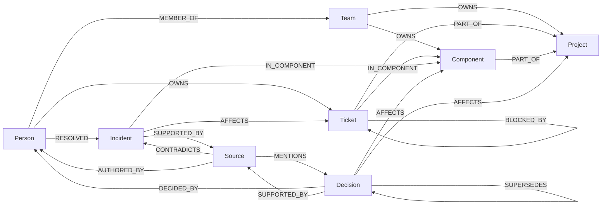

# Node & Nerve

[](https://github.com/harshedabdulla/node-and-nerve/actions/workflows/ci.yml)

An open-source, graph-powered organizational context service for AI agents. Connect company knowledge, discover relationships, trace decisions, and retrieve evidence with [FalkorDB](https://www.falkordb.com/).

> Give any AI agent a connected understanding of how an organization works.

Company Brain is a small HTTP service. You load people, teams, projects, tickets, incidents, decisions and source records into a FalkorDB graph, then ask questions like *"Why is Project Atlas behind schedule, who owns the blockers, and what evidence supports that?"* The service answers with **structured, source-backed evidence** retrieved by fixed Cypher queries. It does not generate a narrative. An LLM (or a person) can reason over the result; the service makes sure the facts and their sources are real.

No LLM, API key, agent framework or particular frontend is required.

The repository contains the reusable engine (the `company_brain` package, also called **Node & Nerve**) and applications of it that share one graph engine, one evidence model and one API:

- **Project Atlas** (organizational context): why is a project late, who owns the blockers, what evidence supports it. Described below.
- **[Contract cost investigation](docs/contract-costing.md)** (manufacturing): how much has a lorry-body contract cost so far, what is its provisional profit, and what is missing. [Jump to the section](#contract-cost-investigation-manufacturing).
- **[Cashflow Radar](docs/cashflow-radar.md)** (small-business receivables): which customers owe money, and which supplier payments or commitments due this week have a *documented* dependency on those collections. [Jump to the section](#cashflow-radar).

---

## The problem

Company knowledge is spread across documents, tickets, chats, postmortems and people's heads. Finding a document is easy. Answering *why* something is happening is harder, because it means joining facts across systems:

- the overdue ticket is blocked by another team's ticket,
- that ticket is affected by an incident,
- the incident's postmortem references an architecture decision,
- that decision replaced an earlier one, and a specific person made it,
- and someone else fixed a similar incident in the same component months ago.

An agent given isolated search results tends to fill those gaps with plausible guesses. Company Brain gives it the connections explicitly, and says what is **not** recorded.

## The solution

- **One graph per company** in FalkorDB holding entities and typed relationships.
- **Provenance everywhere**: sources are first-class nodes, and the graph distinguishes a source that *supports* a record from one that only *mentions* it or *contradicts* it. Relationships can carry the id of the source that asserted them.
- **Current knowledge**: idempotent change events (status changes, ownership changes, new incidents, superseded decisions, withdrawn sources). Ownership history is kept, stale writes are ignored.
- **Deterministic investigations**: a fixed sequence of named, parameterized, bounded Cypher queries. Every finding points to the entities, evidence paths and sources it came from. Gaps are reported as `missing_information`.

## Why FalkorDB is essential

The investigation answer *is* the result of graph traversal. Without the graph there is no answer, only a list of records. Specifically, FalkorDB computes:

| Question | How the graph answers it |
| --- | --- |
| What is blocking the project? | `Project <-PART_OF- Ticket -BLOCKED_BY*0..2-> X <-AFFECTS- Incident` (bounded variable-length traversal, filtered to open work) |
| What evidence backs it? | `-[:SUPPORTED_BY]->(:Source)` vs. `(:Source)-[:MENTIONS\|CONTRADICTS]->` |
| Who owns it now? | `(:Person\|Team)-[o:OWNS]->(x) WHERE o.valid_to IS NULL` |
| Who knows this component? | `RESOLVED` incidents, component `OWNS`, owning-team `MEMBER_OF`, authored incident sources |
| What is the current guidance? | decisions that `AFFECT` the scope with no accepted `SUPERSEDES` edge pointing at them |
| How are two things connected? | bounded undirected paths `(a)-[*1..4]-(b)` ordered by length |

The [evaluation](#evaluation-graph-vs-isolated-records) measures this: given the same records **without** relationships, a keyword baseline retrieves 22% of the required entities for the Atlas question and cannot produce any evidence path. See [docs/cypher.md](docs/cypher.md) for every query.

## Graph model



- Every node has the label `Entity` plus one kind label (`Person`, `Team`, `Project`, `Ticket`, `Incident`, `Decision`, `Component`, `Source`).
- Stable ids encode the kind: `project:atlas`, `ticket:atlas-142`, `source:postmortem-009`. `Entity.id` has a unique constraint.
- Nodes carry `created_at`, `updated_at`, and optionally `source_system` / `source_record_id`. Edges carry `created_at`, `updated_at`, `valid_from`, optional `valid_to` (ownership history) and optional `source_id` (which source asserted the edge).
- The full rule table (which kinds each relationship may connect, and which properties each kind accepts) lives in [`schema.py`](src/company_brain/schema.py) and is served at `GET /v1/schema`.

Details: [docs/graph-model.md](docs/graph-model.md).

## Quickstart

Requirements: Docker, [uv](https://docs.astral.sh/uv/), Python 3.12+.

```sh
git clone https://github.com/harshedabdulla/node-and-nerve && cd node-and-nerve
docker compose up -d falkordb        # FalkorDB on :6379, FalkorDB Browser on :3000
uv sync
uv run company-brain seed            # load the synthetic Northstar Systems graph
uv run company-brain investigate     # run the Atlas investigation in the terminal
```

Start the API:

```sh
uv run uvicorn --factory company_brain.api:app --reload
# OpenAPI docs: http://localhost:8000/docs
```

Or run everything in containers:

```sh
COMPANY_BRAIN_API_KEYS="pick-a-long-random-key=northstar" docker compose --profile api up -d
```

Other commands:

```sh
uv run company-brain eval            # graph vs. isolated-records baseline
uv run company-brain demo-update     # apply change events and show how the answer shifts
uv run company-brain seed --reset    # drop and reload the demo company
uv run company-brain cashflow demo   # Cashflow Radar end to end (see below)
uv run company-brain contracts demo  # manufacturing contract costing end to end (see below)
uv run pytest                        # unit + integration tests (integration needs FalkorDB)
uv run pytest -m "not integration"   # unit tests only, no database
uv run ruff check src tests && uv run mypy
```

Open http://localhost:3000 (FalkorDB Browser), connect to `localhost:6379`, select graph `company_brain__northstar` and run, for example:

```cypher
MATCH p = (:Project {id: 'project:atlas'})<-[:PART_OF]-(:Ticket)-[:BLOCKED_BY]->(:Ticket)<-[:AFFECTS]-(:Incident)-[:SUPPORTED_BY]->(:Source)
RETURN p
```

## The demo scenario

[Northstar Systems](src/company_brain/data/northstar.json) is a fictional company (8 people, 6 teams, 3 projects, 4 components, 6 tickets, 3 incidents, 4 decisions, 11 sources). Its data contains a known explanation for why Project Atlas is late:

- `ticket:atlas-142` (owned by Dev Patel) is blocked and overdue.
- It is blocked by `ticket:int-88` (Integrations, owned by Sam Okafor), asserted by the ATLAS-142 ticket record.
- `incident:inc-009` (v2 webhook signature failures) affects INT-88; its postmortem supports the incident and *mentions* `decision:dec-004`.
- DEC-004 (v2 only, no v1 fallback; decided by Priya Nair) supersedes DEC-002, so falling back to v1 is not current guidance.
- Lena Ortiz resolved a similar incident (INC-007) in the same component.
- A vendor status page *contradicts* INC-009; it is surfaced as a warning.
- `ticket:atlas-147` is also overdue, but nothing in the graph explains it and it has no owner. The service says so instead of guessing.

The complete chain the service returns as one evidence path:

```
ticket:atlas-142 -[PART_OF]-> project:atlas
ticket:atlas-142 -[BLOCKED_BY]-> ticket:int-88          (asserted by source:jira-atlas-142)
incident:inc-009 -[AFFECTS]-> ticket:int-88             (asserted by source:postmortem-009)
incident:inc-009 -[SUPPORTED_BY]-> source:postmortem-009
source:postmortem-009 -[MENTIONS]-> decision:dec-004
decision:dec-004 -[DECIDED_BY]-> person:priya-nair
```

## Contract cost investigation (manufacturing)

The same engine, a different domain. A small lorry-body builder records purchases, wages, machinery costs, expenses and payments in separate paper books, and sends them to the CA at month end. It can't easily tell what a contract has cost so far. Full documentation, including the calculation model: [docs/contract-costing.md](docs/contract-costing.md).

```sh
uv run company-brain contracts seed --reset         # synthetic Kaveri Body Works: 5 contracts, 9 jobs, 131 records
uv run company-brain contracts investigate CT-104   # cost, provisional profit, what is missing
uv run company-brain contracts overview             # every contract, which have incomplete costs
uv run company-brain contracts unallocated          # costs not charged to any contract
uv run company-brain contracts demo                 # re-seed is a no-op; new entries change the answer
```

FalkorDB traverses `Contract <-PART_OF*0..1- Job <-CHARGED_TO {amount}- Purchase|Wage|MachineryCost|Expense`. From each entry it continues to the supplier or worker, the payments that settle it, and the book page that recorded it. A cost reaches a contract only through a `CHARGED_TO` edge, and only the amount on that edge counts. Shared bills are split, never copied. Entries the book only notes for a contract, without a split, are reported as decisions, not cost. Payments settle bills; they are never cost.

Real output for CT-104 (abridged):

```
Recorded direct cost (provisional)
  Materials          ₹7,59,900
  Labour               ₹71,500
  Machinery            ₹11,800
  Other direct          ₹8,500
  Total              ₹8,51,700
  (27 book entries, 35 charges; excluded: PUR-2056)

Profitability (provisional, recorded direct costs only)
  Contract value           ₹15,30,000
  Provisional profit        ₹6,78,300  (44.3% of contract value)
  If all ₹32,100 of unsplit costs noted for it were charged here: ₹6,46,200

Decisions needed
  - PUR-2053 (PU enamel paint, ₹28,500) is noted for CT-104, CT-105 with no split recorded. [...]
  - SP-309: ₹25,000 paid to Sri Balaji Steels on 14 Oct 2026 is not applied to any bill. [...]
Unknown, to verify
  - WG-416: Murugan, Welding, 4 days, ₹3,600 has no job recorded. [...]
  - PUR-2055 (Lakshmi Welding Stores, ₹31,000): payment SP-307 is recorded but not cleared. [...]
Inconsistencies between books
  - PUR-2058 (Sri Balaji Steels, ₹58,000): the purchase book says 'paid', but the supplier payment book shows ₹0 [...]
```

Full JSON: [examples/contract-investigation.json](examples/contract-investigation.json).

Ask in plain language, from the terminal or Telegram. An LLM (via OpenRouter) calls the investigations as tools, cites book pages and keeps figures provisional. Each answer links to a signed **evidence-graph trace page**, drawn live from FalkorDB, with the items in the answer highlighted:

```sh
uv run company-brain ask "Which bills on CT-104 are still unpaid, and which are unclear?"
uv run company-brain telegram     # private bot: /contracts, /contract CT-104, /unallocated, or ask
```

Setup and safety rules are in [docs/contract-costing.md](docs/contract-costing.md#ai-agent-telegram-bot-and-evidence-graph-trace-links).

## Cashflow Radar

A focused business application on the same engine, for a small distributor that keeps its records in spreadsheets, accounting exports and chat messages. Full documentation: [docs/cashflow-radar.md](docs/cashflow-radar.md).

```sh
uv run company-brain cashflow seed --reset    # import synthetic Varsha Electricals (Pune) from CSV
uv run company-brain cashflow investigate     # as of 2026-10-16, commitments due within 7 days
uv run company-brain cashflow demo            # re-import (no change), later payments, stale export
uv run company-brain cashflow import ./my-csvs --dry-run   # validate your own files
```

What it does:

1. Imports customers, suppliers, invoices, payments and allocations, sales and purchase orders, commitments, recorded dependencies and source documents from CSV ([templates](examples/cashflow-templates)). Every row is validated (types, dates, INR amounts, references, company) before anything is written; re-imports are idempotent and older rows never overwrite newer ones.
2. Stores them as typed nodes and edges in the company's FalkorDB graph, with the source document that asserted each link.
3. Investigates with four fixed Cypher queries: outstanding balances computed from *cleared* allocated payments, open non-superseded commitments due in the window, and the traversal `Customer <-BILLED_TO- Invoice <-DEPENDS_ON- Commitment -OWED_TO-> Supplier`, extended through `-FOR_ORDER-> PurchaseOrder <-SOURCED_FROM- SalesOrder -PLACED_BY-> Customer`.
4. Returns findings marked `documented` or `recorded_without_source`, evidence paths, sources, conflicts, missing information, open questions, next steps, and draft reminders that are never sent.

It never infers that an overdue invoice puts a payment at risk: a dependency exists only if it was recorded, and it is "documented" only if an active source backs it. Example (real output, abridged):

```
Needs attention
  1. Follow up with Shree Ganesh Contractors about INV-1001 (₹3,00,000 outstanding) before 21 Oct 2026:
     COM-201 to Kiran Cables Pvt Ltd (₹3,50,000) is documented as depending on it.
  2. Confirm whether COM-203 really depends on INV-1004, and record the document that says so.
  3. Review SRC-008 'Email from Patil Builders, 3 Oct 2026' disputing INV-1002 before sending a payment reminder.

  [+] collection dependency: COM-201 'Pay Kiran Cables for PO-301' (₹3,50,000 to Kiran Cables Pvt Ltd, due 21 Oct 2026)
      is recorded as depending on collecting INV-1001 from Shree Ganesh Contractors (₹3,00,000 outstanding, 15 days
      overdue). Documented by SRC-007 'WhatsApp message to Kiran Cables, 12 Oct 2026'.
  [+] linked order: COM-201 pays for PO-301 (status: received), which supplies SO-105 for Shree Ganesh Contractors
      (the same customer that owes INV-1001); status: open, required by 22 Oct 2026.

Not established by the records
  ? No dependency on a customer collection is recorded for COM-202R (Sunrise Switchgear, ₹2,40,000). Whether it
    relies on incoming payments is not recorded.
```

Full JSON: [examples/cashflow-investigation.json](examples/cashflow-investigation.json). Google Sheets and Telegram were evaluated and documented, not built ([details](docs/cashflow-radar.md#integrations-evaluated-not-implemented)).

## API

| Method | Path | Purpose |
| --- | --- | --- |
| GET | `/health` | Liveness. Does not touch the database. |
| GET | `/ready` | Readiness. 503 unless FalkorDB answers graph commands. |
| GET | `/v1/schema` | Allowed kinds, properties and relationships. |
| POST | `/v1/companies/{company}/entities` | Create or update an entity. |
| POST | `/v1/companies/{company}/relationships` | Create or update an allowed relationship. |
| POST | `/v1/companies/{company}/sources` | Register a source and what it supports / mentions / contradicts. |
| POST | `/v1/companies/{company}/events` | Apply a change event. |
| POST | `/v1/companies/{company}/investigations` | Retrieve connected evidence for a question. |
| GET | `/v1/companies/{company}/entities/{id}` | Entity with its relationships. |
| GET | `/v1/companies/{company}/decisions/{id}/sources` | Decision provenance. |
| GET | `/v1/companies/{company}/connections?from=&to=&max_depth=` | Bounded paths between two entities. |
| POST | `/v1/companies/{company}/cashflow/imports` | Cashflow Radar: validate and import CSV records (`dry_run` supported). |
| POST | `/v1/companies/{company}/cashflow/investigations` | Cashflow Radar: receivables and documented dependencies. |
| POST | `/v1/companies/{company}/contracts/investigations` | Contract costing: recorded cost, provisional profit, gaps for one contract. |
| GET | `/v1/companies/{company}/contracts` | Contract costing: all contracts and which have incomplete costs. |
| GET | `/v1/companies/{company}/costs/unallocated` | Contract costing: costs not charged to any contract. |
| GET | `/v1/companies/{company}/costs/changes?since=` | Contract costing: entries and allocations changed since a timestamp. |

There is deliberately no endpoint that accepts Cypher.

### Investigation request

```sh
curl -s -X POST localhost:8000/v1/companies/northstar/investigations \
  -H 'Content-Type: application/json' -H "X-API-Key: $KEY" \
  -d '{"question": "Why is Project Atlas behind schedule, who owns the blockers?", "as_of": "2026-10-16"}'
```

`focus_ids` (projects, components or tickets) can be passed instead of relying on name matching. `as_of` defaults to today and decides what is overdue.

### Investigation response (abridged, real output)

The full response is in [examples/atlas-investigation.json](examples/atlas-investigation.json).

```json
{
  "investigation_id": "inv_…",
  "company_id": "northstar",
  "matched_entities": [{"id": "project:atlas", "kind": "project", "match_reason": "name or id matches 'atlas'"}],
  "findings": [
    {"id": "finding-2", "category": "blocker_dependency",
     "statement": "ticket:atlas-142 is blocked by ticket:int-88 'Enable v2 webhook signing in production' (status: blocked)",
     "entity_ids": ["ticket:atlas-142", "ticket:int-88"], "path_ids": ["path-2"],
     "source_ids": ["source:jira-atlas-142"], "supported": true},
    {"id": "finding-6", "category": "incident",
     "statement": "incident:inc-009 'Billing Gateway v2 webhook signature verification failures' (mitigated, sev2) affects the blocker chain of ticket:atlas-142",
     "path_ids": ["path-4", "path-5"], "source_ids": ["source:chat-inc-009", "source:postmortem-009"], "supported": true}
  ],
  "evidence_paths": [{"id": "path-5", "description": "evidence chain from ticket:atlas-142 to decision:dec-004", "edges": ["…"]}],
  "sources": [{"id": "source:postmortem-009", "relation": "supports", "about": "incident:inc-009",
               "uri": "https://docs.northstar.example/postmortems/inc-009", "status": "active"}],
  "current_owners": [{"entity_id": "ticket:atlas-142", "owner_id": "person:dev-patel", "source_id": "source:jira-atlas-142"}],
  "experts": [{"person_id": "person:lena-ortiz", "score": 4, "basis": [{"basis": "resolved_incident", "evidence_id": "incident:inc-007"}]}],
  "decisions": [
    {"id": "decision:dec-004", "current": true, "supersedes": ["decision:dec-002"]},
    {"id": "decision:dec-002", "current": false, "superseded_by": ["decision:dec-004"]}
  ],
  "missing_information": [
    "ticket:atlas-147 is overdue but the graph records no blocker, incident or status explaining the delay.",
    "No current owner is recorded for ticket:atlas-147."
  ],
  "warnings": ["source:vendor-status-0922 contradicts incident:inc-009; review before relying on it"],
  "queries_executed": ["resolve_entities", "tickets_in_scope", "ticket_status", "ticket_incident_paths", "…"]
}
```

`statement` strings are rendered from graph rows by fixed templates. They are not conclusions; `supported: false` means the fact is in the graph but no active source backs it.

More requests: [examples/curl.sh](examples/curl.sh). A dependency-free Python client: [examples/client.py](examples/client.py).

### Keeping knowledge current

```sh
curl -s -X POST localhost:8000/v1/companies/northstar/events -H 'Content-Type: application/json' \
  -d '{"type": "ownership_changed", "event_id": "evt-001", "entity_id": "ticket:atlas-142",
       "new_owner_id": "person:lena-ortiz", "occurred_at": "2026-10-16T10:00:00Z"}'
# {"event_id":"evt-001","type":"ownership_changed",
#  "changes":["person:dev-patel no longer owns ticket:atlas-142","person:lena-ortiz owns ticket:atlas-142"]}
```

Event types: `ticket_status_changed`, `ownership_changed`, `incident_recorded`, `decision_superseded`, `source_withdrawn`. All are idempotent (MERGE on stable ids); replaying an event changes nothing. Entity writes older than the stored `updated_at` are ignored. `company-brain demo-update` shows each event and the resulting change in the investigation.

## Evaluation: graph vs. isolated records

`uv run company-brain eval` reseeds the demo graph and runs two scenarios with predefined expected entities, a required evidence path, required sources, a superseded decision, expected missing information and entities that must *not* appear. The baseline receives the same entity and source records (names, properties, excerpts) without relationships and ranks them by keyword overlap with the question.

```
scenario                   system    entities  path   sources  superseded excl.  missing flagged  leaked
atlas_delay                graph     1.0       True   1.0      True              True             0
atlas_delay                baseline  0.222     False  0.333    True              False            0
billing_gateway_expertise  graph     1.0       True   1.0      True              True             0
billing_gateway_expertise  baseline  0.571     False  0.333    False             True             0
```

How to read it honestly:

- The scenarios and dataset were written by the same author as the service, so a perfect graph score shows the queries retrieve what the data encodes, not general accuracy.
- The baseline is intentionally simple (keyword overlap, top 10). A vector index would retrieve more records, but it still would not know that INT-88 *blocks* ATLAS-142, that DEC-004 *supersedes* DEC-002, or that no owner exists for ATLAS-147. Those facts exist only as relationships.
- "superseded excl. = True" for the Atlas baseline is vacuous: it did not retrieve DEC-002 at all. "missing flagged = True" for the second baseline is also vacuous: that scenario expects no missing items.

The scoring code is in [`evaluation.py`](src/company_brain/evaluation.py) and runs in CI.

## Architecture

```
HTTP API (FastAPI, validation, API keys)        api.py, auth.py, models.py
    │
Application services                            investigate.py, ingest.py, lookup.py,
                                                cashflow.py, csv_import.py, contract_cost.py
    │
Named query templates + schema rules            queries.py, schema.py
    │
GraphStore interface → FalkorDB adapter         graph.py
    │
FalkorDB (one graph per company)
```

Services only run `Query` objects from `queries.py`; the store rejects raw strings. Unit tests replace the store with an in-memory fake; integration tests use a real FalkorDB. More in [docs/architecture.md](docs/architecture.md).

## Security model and limitations

- **Tenant isolation**: one FalkorDB graph per company, named `company_brain__<id>`. Company ids are validated against `^[a-z0-9](?:[a-z0-9-]{0,46}[a-z0-9])?$` before a graph name is derived; callers cannot name a graph. Tests check cross-tenant reads return nothing.
- **Authentication** is optional and simple: `COMPANY_BRAIN_API_KEYS="key=company1|company2"`. Keys are compared in constant time and scoped to companies. There are no users, roles, key rotation or audit log. **If the variable is empty, auth is off.** Do not expose an unauthenticated instance.
- **Query safety**: fixed templates only, values passed as parameters, labels and relationship types taken from enums, read paths executed with `GRAPH.RO_QUERY`, traversal depth bounded (≤4), result limits, per-query timeouts (`FALKORDB_QUERY_TIMEOUT_MS`) plus a server-side `TIMEOUT_MAX`.
- **Failure behaviour**: if FalkorDB is unreachable the API returns 503; it never returns an empty or invented result in its place.
- FalkorDB credentials stay server-side and are never logged or returned.

See [SECURITY.md](SECURITY.md).

Current limitations:

- Entity matching from a question is a deterministic word match on names and ids, not semantic search. Pass `focus_ids` for precision.
- Investigations focus on projects, components and tickets. Blocker chains are followed two hops; paths at most four.
- Expertise weights (resolved incident 3, owns component 2, authored incident source 1, member of owning team 1) are a fixed heuristic.
- Re-assigning ownership back to a previous owner reuses (and reopens) the earlier `OWNS` edge, so that interval's history is overwritten.
- No document parsing or external connectors yet; data comes in through the API, CSV import or the seed files.
- Built and tested against FalkorDB v4.20.7 only. See dialect notes in [docs/cypher.md](docs/cypher.md).

## Using it from an agent

Company Brain returns evidence; the caller decides what to do with it. A typical loop:

1. The agent receives a question.
2. It calls `POST /investigations` (and optionally `GET /decisions/{id}/sources` or `/connections`).
3. It reasons or summarizes over `findings`, citing `source_ids`, and treats `missing_information` and `warnings` as open questions rather than filling them in.

This works the same from Python, TypeScript, Go or a shell script, since it is plain JSON over HTTP. A future integration with [Spindle](https://heyspindle.com/)'s agent engine would call the same API; nothing here depends on Spindle.

Ideas for connectors (Jira/GitHub issues, Slack, documents, CRM) are in [docs/connectors.md](docs/connectors.md).

## Live deployment

- Site: https://node-and-nerve.vercel.app (source in [`web/`](web/); `/demo` runs the CT-104 and Project Atlas investigations live on fictional data)
- API: https://node-and-nerve-api.vercel.app (`/docs` for OpenAPI; contract endpoints need an API key)
- Graph: FalkorDB Cloud (AWS Mumbai); API functions run in Vercel `bom1` next to it
- Telegram: `@node_and_nerve_bot` in webhook mode (`POST /telegram/webhook`, checked against `TELEGRAM_WEBHOOK_SECRET`); private to allow-listed chats

Where the product is going (accounts, workspaces, connectors, notifications) and what is built versus planned: [docs/platform-architecture.md](docs/platform-architecture.md).

Deploy your own: `vercel.json` and `api/index.py` serve the FastAPI app as a Vercel Python function. Seed the cloud graph from your machine with the cloud `FALKORDB_*` values exported (`company-brain seed --reset`, `contracts seed --reset`, `cashflow seed --reset`), set the same variables plus `COMPANY_BRAIN_API_KEYS`, `TRACE_LINK_SECRET`, `PUBLIC_BASE_URL` and the Telegram ones in the Vercel project, then `vercel deploy --prod` and `company-brain telegram --webhook <api>/telegram/webhook`. `company-brain telegram --delete-webhook` switches back to local polling.

## Hackathon submission

- **Event**: Graph Hacks: Context for AI Agents (WeMakeDevs × FalkorDB), October 15–18, 2026.
- **Track**: 03 — Company Brain.
- **Timeline**: this repository was created and all code was written during the hackathon window, starting October 15, 2026. No pre-existing code was used apart from the open-source libraries listed in `pyproject.toml`.
- **Data**: all data is synthetic. Northstar Systems, Varsha Electricals and Kaveri Body Works, their people, customers, suppliers, workers, vehicle numbers, amounts, documents and URIs (`*.example`) are fictional.
- **Cashflow Radar** and the **manufacturing contract cost investigation** were added on October 16, 2026, on top of the engine built on October 15.
- **AI assistance disclosure**: built with the help of an AI coding assistant (Claude Code, by Anthropic), which wrote much of the code and documentation under the author's direction. The author reviewed the design, graph model, queries and results, and can explain them.

## License

[MIT](LICENSE)
