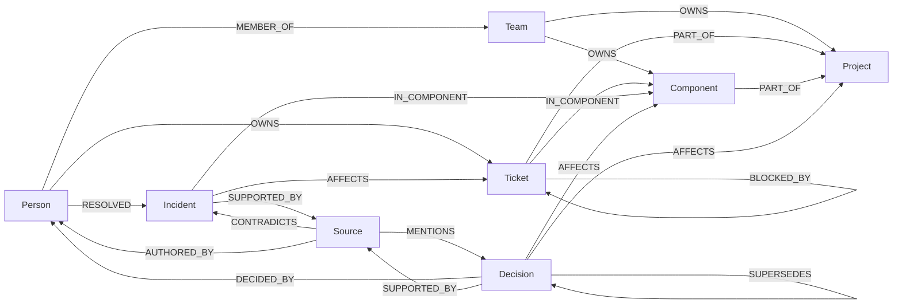

# Company Brain

[](https://github.com/harshedabdulla/node-and-nerve/actions/workflows/ci.yml)

An open-source, graph-powered organizational context service for AI agents. Connect company knowledge, discover relationships, trace decisions, and retrieve evidence with [FalkorDB](https://www.falkordb.com/).

> Give any AI agent a connected understanding of how an organization works.

Company Brain is a small HTTP service. You load people, teams, projects, tickets, incidents, decisions and source records into a FalkorDB graph, then ask questions like *"Why is Project Atlas behind schedule, who owns the blockers, and what evidence supports that?"* The service answers with **structured, source-backed evidence** retrieved by fixed Cypher queries. It does not generate a narrative. An LLM (or a person) can reason over the result; the service makes sure the facts and their sources are real.

No LLM, API key, agent framework or particular frontend is required.

---

## The problem

Company knowledge is spread across documents, tickets, chats, postmortems and people's heads. Finding a document is easy. Answering *why* something is happening is harder, because it means joining facts across systems:

- the overdue ticket is blocked by another team's ticket,
- that ticket is affected by an incident,
- the incident's postmortem references an architecture decision,
- that decision replaced an earlier one, and a specific person made it,
- and someone else fixed a similar incident in the same component months ago.

An agent given isolated search results tends to fill those gaps with plausible guesses. Company Brain gives it the connections explicitly, and says what is **not** recorded.

## The solution

- **One graph per company** in FalkorDB holding entities and typed relationships.
- **Provenance everywhere**: sources are first-class nodes, and the graph distinguishes a source that *supports* a record from one that only *mentions* it or *contradicts* it. Relationships can carry the id of the source that asserted them.
- **Current knowledge**: idempotent change events (status changes, ownership changes, new incidents, superseded decisions, withdrawn sources). Ownership history is kept, stale writes are ignored.
- **Deterministic investigations**: a fixed sequence of named, parameterized, bounded Cypher queries. Every finding points to the entities, evidence paths and sources it came from. Gaps are reported as `missing_information`.

## Why FalkorDB is essential

The investigation answer *is* the result of graph traversal. Without the graph there is no answer, only a list of records. Specifically, FalkorDB computes:

| Question | How the graph answers it |
| --- | --- |
| What is blocking the project? | `Project <-PART_OF- Ticket -BLOCKED_BY*0..2-> X <-AFFECTS- Incident` (bounded variable-length traversal, filtered to open work) |
| What evidence backs it? | `-[:SUPPORTED_BY]->(:Source)` vs. `(:Source)-[:MENTIONS\|CONTRADICTS]->` |
| Who owns it now? | `(:Person\|Team)-[o:OWNS]->(x) WHERE o.valid_to IS NULL` |
| Who knows this component? | `RESOLVED` incidents, component `OWNS`, owning-team `MEMBER_OF`, authored incident sources |
| What is the current guidance? | decisions that `AFFECT` the scope with no accepted `SUPERSEDES` edge pointing at them |
| How are two things connected? | bounded undirected paths `(a)-[*1..4]-(b)` ordered by length |

The [evaluation](#evaluation-graph-vs-isolated-records) measures this: given the same records **without** relationships, a keyword baseline retrieves 22% of the required entities for the Atlas question and cannot produce any evidence path. See [docs/cypher.md](docs/cypher.md) for every query.

## Graph model



- Every node has the label `Entity` plus one kind label (`Person`, `Team`, `Project`, `Ticket`, `Incident`, `Decision`, `Component`, `Source`).
- Stable ids encode the kind: `project:atlas`, `ticket:atlas-142`, `source:postmortem-009`. `Entity.id` has a unique constraint.
- Nodes carry `created_at`, `updated_at`, and optionally `source_system` / `source_record_id`. Edges carry `created_at`, `updated_at`, `valid_from`, optional `valid_to` (ownership history) and optional `source_id` (which source asserted the edge).
- The full rule table (which kinds each relationship may connect, and which properties each kind accepts) lives in [`schema.py`](src/company_brain/schema.py) and is served at `GET /v1/schema`.

Details: [docs/graph-model.md](docs/graph-model.md).

## Quickstart

Requirements: Docker, [uv](https://docs.astral.sh/uv/), Python 3.12+.

```sh
git clone https://github.com/harshedabdulla/node-and-nerve && cd node-and-nerve
docker compose up -d falkordb        # FalkorDB on :6379, FalkorDB Browser on :3000
uv sync
uv run company-brain seed            # load the synthetic Northstar Systems graph
uv run company-brain investigate     # run the Atlas investigation in the terminal
```

Start the API:

```sh
uv run uvicorn --factory company_brain.api:app --reload
# OpenAPI docs: http://localhost:8000/docs
```

Or run everything in containers:

```sh
COMPANY_BRAIN_API_KEYS="pick-a-long-random-key=northstar" docker compose --profile api up -d
```

Other commands:

```sh
uv run company-brain eval            # graph vs. isolated-records baseline
uv run company-brain demo-update     # apply change events and show how the answer shifts
uv run company-brain seed --reset    # drop and reload the demo company
uv run pytest                        # unit + integration tests (integration needs FalkorDB)
uv run pytest -m "not integration"   # unit tests only, no database
uv run ruff check src tests && uv run mypy
```

Open http://localhost:3000 (FalkorDB Browser), connect to `localhost:6379`, select graph `company_brain__northstar` and run, for example:

```cypher
MATCH p = (:Project {id: 'project:atlas'})<-[:PART_OF]-(:Ticket)-[:BLOCKED_BY]->(:Ticket)<-[:AFFECTS]-(:Incident)-[:SUPPORTED_BY]->(:Source)
RETURN p
```

## The demo scenario

[Northstar Systems](src/company_brain/data/northstar.json) is a fictional company (8 people, 6 teams, 3 projects, 4 components, 6 tickets, 3 incidents, 4 decisions, 11 sources). Its data contains a known explanation for why Project Atlas is late:

- `ticket:atlas-142` (owned by Dev Patel) is blocked and overdue.
- It is blocked by `ticket:int-88` (Integrations, owned by Sam Okafor), asserted by the ATLAS-142 ticket record.
- `incident:inc-009` (v2 webhook signature failures) affects INT-88; its postmortem supports the incident and *mentions* `decision:dec-004`.
- DEC-004 (v2 only, no v1 fallback; decided by Priya Nair) supersedes DEC-002, so falling back to v1 is not current guidance.
- Lena Ortiz resolved a similar incident (INC-007) in the same component.
- A vendor status page *contradicts* INC-009; it is surfaced as a warning.
- `ticket:atlas-147` is also overdue, but nothing in the graph explains it and it has no owner. The service says so instead of guessing.

The complete chain the service returns as one evidence path:

```
ticket:atlas-142 -[PART_OF]-> project:atlas
ticket:atlas-142 -[BLOCKED_BY]-> ticket:int-88          (asserted by source:jira-atlas-142)
incident:inc-009 -[AFFECTS]-> ticket:int-88             (asserted by source:postmortem-009)
incident:inc-009 -[SUPPORTED_BY]-> source:postmortem-009
source:postmortem-009 -[MENTIONS]-> decision:dec-004
decision:dec-004 -[DECIDED_BY]-> person:priya-nair
```

## API

| Method | Path | Purpose |
| --- | --- | --- |
| GET | `/health` | Liveness. Does not touch the database. |
| GET | `/ready` | Readiness. 503 unless FalkorDB answers graph commands. |
| GET | `/v1/schema` | Allowed kinds, properties and relationships. |
| POST | `/v1/companies/{company}/entities` | Create or update an entity. |
| POST | `/v1/companies/{company}/relationships` | Create or update an allowed relationship. |
| POST | `/v1/companies/{company}/sources` | Register a source and what it supports / mentions / contradicts. |
| POST | `/v1/companies/{company}/events` | Apply a change event. |
| POST | `/v1/companies/{company}/investigations` | Retrieve connected evidence for a question. |
| GET | `/v1/companies/{company}/entities/{id}` | Entity with its relationships. |
| GET | `/v1/companies/{company}/decisions/{id}/sources` | Decision provenance. |
| GET | `/v1/companies/{company}/connections?from=&to=&max_depth=` | Bounded paths between two entities. |

There is deliberately no endpoint that accepts Cypher.

### Investigation request

```sh
curl -s -X POST localhost:8000/v1/companies/northstar/investigations \
  -H 'Content-Type: application/json' -H "X-API-Key: $KEY" \
  -d '{"question": "Why is Project Atlas behind schedule, who owns the blockers?", "as_of": "2026-10-16"}'
```

`focus_ids` (projects, components or tickets) can be passed instead of relying on name matching. `as_of` defaults to today and decides what is overdue.

### Investigation response (abridged, real output)

The full response is in [examples/atlas-investigation.json](examples/atlas-investigation.json).

```json
{
  "investigation_id": "inv_…",
  "company_id": "northstar",
  "matched_entities": [{"id": "project:atlas", "kind": "project", "match_reason": "name or id matches 'atlas'"}],
  "findings": [
    {"id": "finding-2", "category": "blocker_dependency",
     "statement": "ticket:atlas-142 is blocked by ticket:int-88 'Enable v2 webhook signing in production' (status: blocked)",
     "entity_ids": ["ticket:atlas-142", "ticket:int-88"], "path_ids": ["path-2"],
     "source_ids": ["source:jira-atlas-142"], "supported": true},
    {"id": "finding-6", "category": "incident",
     "statement": "incident:inc-009 'Billing Gateway v2 webhook signature verification failures' (mitigated, sev2) affects the blocker chain of ticket:atlas-142",
     "path_ids": ["path-4", "path-5"], "source_ids": ["source:chat-inc-009", "source:postmortem-009"], "supported": true}
  ],
  "evidence_paths": [{"id": "path-5", "description": "evidence chain from ticket:atlas-142 to decision:dec-004", "edges": ["…"]}],
  "sources": [{"id": "source:postmortem-009", "relation": "supports", "about": "incident:inc-009",
               "uri": "https://docs.northstar.example/postmortems/inc-009", "status": "active"}],
  "current_owners": [{"entity_id": "ticket:atlas-142", "owner_id": "person:dev-patel", "source_id": "source:jira-atlas-142"}],
  "experts": [{"person_id": "person:lena-ortiz", "score": 4, "basis": [{"basis": "resolved_incident", "evidence_id": "incident:inc-007"}]}],
  "decisions": [
    {"id": "decision:dec-004", "current": true, "supersedes": ["decision:dec-002"]},
    {"id": "decision:dec-002", "current": false, "superseded_by": ["decision:dec-004"]}
  ],
  "missing_information": [
    "ticket:atlas-147 is overdue but the graph records no blocker, incident or status explaining the delay.",
    "No current owner is recorded for ticket:atlas-147."
  ],
  "warnings": ["source:vendor-status-0922 contradicts incident:inc-009; review before relying on it"],
  "queries_executed": ["resolve_entities", "tickets_in_scope", "ticket_status", "ticket_incident_paths", "…"]
}
```

`statement` strings are rendered from graph rows by fixed templates. They are not conclusions; `supported: false` means the fact is in the graph but no active source backs it.

More requests: [examples/curl.sh](examples/curl.sh). A dependency-free Python client: [examples/client.py](examples/client.py).

### Keeping knowledge current

```sh
curl -s -X POST localhost:8000/v1/companies/northstar/events -H 'Content-Type: application/json' \
  -d '{"type": "ownership_changed", "event_id": "evt-001", "entity_id": "ticket:atlas-142",
       "new_owner_id": "person:lena-ortiz", "occurred_at": "2026-10-16T10:00:00Z"}'
# {"event_id":"evt-001","type":"ownership_changed",
#  "changes":["person:dev-patel no longer owns ticket:atlas-142","person:lena-ortiz owns ticket:atlas-142"]}
```

Event types: `ticket_status_changed`, `ownership_changed`, `incident_recorded`, `decision_superseded`, `source_withdrawn`. All are idempotent (MERGE on stable ids); replaying an event changes nothing. Entity writes older than the stored `updated_at` are ignored. `company-brain demo-update` shows each event and the resulting change in the investigation.

## Evaluation: graph vs. isolated records

`uv run company-brain eval` reseeds the demo graph and runs two scenarios with predefined expected entities, a required evidence path, required sources, a superseded decision, expected missing information and entities that must *not* appear. The baseline receives the same entity and source records (names, properties, excerpts) without relationships and ranks them by keyword overlap with the question.

```
scenario                   system    entities  path   sources  superseded excl.  missing flagged  leaked
atlas_delay                graph     1.0       True   1.0      True              True             0
atlas_delay                baseline  0.222     False  0.333    True              False            0
billing_gateway_expertise  graph     1.0       True   1.0      True              True             0
billing_gateway_expertise  baseline  0.571     False  0.333    False             True             0
```

How to read it honestly:

- The scenarios and dataset were written by the same author as the service, so a perfect graph score shows the queries retrieve what the data encodes, not general accuracy.
- The baseline is intentionally simple (keyword overlap, top 10). A vector index would retrieve more records, but it still would not know that INT-88 *blocks* ATLAS-142, that DEC-004 *supersedes* DEC-002, or that no owner exists for ATLAS-147. Those facts exist only as relationships.
- "superseded excl. = True" for the Atlas baseline is vacuous: it did not retrieve DEC-002 at all. "missing flagged = True" for the second baseline is also vacuous: that scenario expects no missing items.

The scoring code is in [`evaluation.py`](src/company_brain/evaluation.py) and runs in CI.

## Architecture

```
HTTP API (FastAPI, validation, API keys)        api.py, auth.py, models.py
    │
Application services                            investigate.py, ingest.py, lookup.py
    │
Named query templates + schema rules            queries.py, schema.py
    │
GraphStore interface → FalkorDB adapter         graph.py
    │
FalkorDB (one graph per company)
```

Services only run `Query` objects from `queries.py`; the store rejects raw strings. Unit tests replace the store with an in-memory fake; integration tests use a real FalkorDB. More in [docs/architecture.md](docs/architecture.md).

## Security model and limitations

- **Tenant isolation**: one FalkorDB graph per company, named `company_brain__<id>`. Company ids are validated against `^[a-z0-9](?:[a-z0-9-]{0,46}[a-z0-9])?$` before a graph name is derived; callers cannot name a graph. Tests check cross-tenant reads return nothing.
- **Authentication** is optional and simple: `COMPANY_BRAIN_API_KEYS="key=company1|company2"`. Keys are compared in constant time and scoped to companies. There are no users, roles, key rotation or audit log. **If the variable is empty, auth is off.** Do not expose an unauthenticated instance.
- **Query safety**: fixed templates only, values passed as parameters, labels and relationship types taken from enums, read paths executed with `GRAPH.RO_QUERY`, traversal depth bounded (≤4), result limits, per-query timeouts (`FALKORDB_QUERY_TIMEOUT_MS`) plus a server-side `TIMEOUT_MAX`.
- **Failure behaviour**: if FalkorDB is unreachable the API returns 503; it never returns an empty or invented result in its place.
- FalkorDB credentials stay server-side and are never logged or returned.

See [SECURITY.md](SECURITY.md).

Current limitations:

- Entity matching from a question is a deterministic word match on names and ids, not semantic search. Pass `focus_ids` for precision.
- Investigations focus on projects, components and tickets. Blocker chains are followed two hops; paths at most four.
- Expertise weights (resolved incident 3, owns component 2, authored incident source 1, member of owning team 1) are a fixed heuristic.
- Re-assigning ownership back to a previous owner reuses (and reopens) the earlier `OWNS` edge, so that interval's history is overwritten.
- No document parsing or external connectors yet; data comes in through the API or the seed file.
- Built and tested against FalkorDB v4.20.7 only. See dialect notes in [docs/cypher.md](docs/cypher.md).

## Using it from an agent

Company Brain returns evidence; the caller decides what to do with it. A typical loop:

1. The agent receives a question.
2. It calls `POST /investigations` (and optionally `GET /decisions/{id}/sources` or `/connections`).
3. It reasons or summarizes over `findings`, citing `source_ids`, and treats `missing_information` and `warnings` as open questions rather than filling them in.

This works the same from Python, TypeScript, Go or a shell script, since it is plain JSON over HTTP. A future integration with [Spindle](https://heyspindle.com/)'s agent engine would call the same API; nothing here depends on Spindle.

Ideas for connectors (Jira/GitHub issues, Slack, documents, CRM) are in [docs/connectors.md](docs/connectors.md).

## Hackathon submission

- **Event**: Graph Hacks: Context for AI Agents (WeMakeDevs × FalkorDB), October 15–18, 2026.
- **Track**: 03 — Company Brain.
- **Timeline**: this repository was created and all code was written during the hackathon window, starting October 15, 2026. No pre-existing code was used apart from the open-source libraries listed in `pyproject.toml`.
- **Data**: all data is synthetic. Northstar Systems, its people, vendors and URIs (`*.example`) are fictional.
- **AI assistance disclosure**: built with the help of an AI coding assistant (Claude Code, by Anthropic), which wrote much of the code and documentation under the author's direction. The author reviewed the design, graph model, queries and results, and can explain them.

## License

[MIT](LICENSE)
