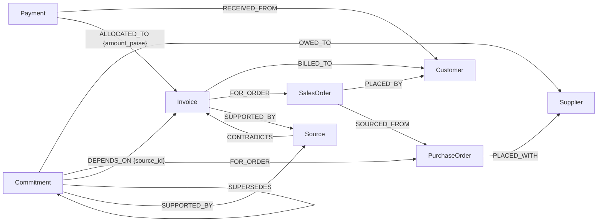

# Cashflow Radar

Cashflow Radar is a business application built on the Node & Nerve engine (the `company_brain` package). It helps a small distributor answer:

> Which customers owe us money, and which supplier payments or commitments due this week have a **documented** dependency on those collections?

It imports the business's records (customers, suppliers, invoices, payments, orders, commitments and the documents behind them) into the company's FalkorDB graph, follows the recorded relationships, and returns findings with the evidence and source records behind each one. It also says what the records do **not** establish.

It is not an accounting system, a forecast or a chatbot. It does not send messages or make payments. It is a product hypothesis to test with real businesses; the data in this repository is synthetic.

## What it does today (implemented and tested)

| Step | How |
| --- | --- |
| Import records | CSV files, from the CLI (`company-brain cashflow import DIR`) or the API (`POST /v1/companies/{id}/cashflow/imports`). All rows are validated before anything is written. |
| Store as a graph | Each record becomes a node; each reference (invoice → customer, payment → invoice, commitment → invoice it depends on) becomes a typed edge carrying the source that asserted it. |
| Investigate | `company-brain cashflow investigate` or `POST /v1/companies/{id}/cashflow/investigations`. Four fixed, parameterized Cypher queries. No LLM. |
| Explain | Findings marked `documented` (an active source backs them) or `recorded_without_source`; evidence paths; source records; open questions; missing information; conflicts; next steps; draft follow-up messages for review (never sent). |

Not implemented: Google Sheets import, Telegram/WhatsApp, a UI. See [Integrations](#integrations-evaluated-not-implemented).

## Run the demo

```sh
docker compose up -d falkordb
uv sync
uv run company-brain cashflow seed --reset     # load Varsha Electricals (synthetic) from CSV
uv run company-brain cashflow investigate      # as of 2026-10-16, commitments due within 7 days
uv run company-brain cashflow demo             # import, re-import, later records, stale export
```

Options: `--as-of YYYY-MM-DD`, `--days N` (1–31), `--json`. `--company ID` (before `cashflow`) selects another tenant; the default is `varsha-electricals`. Import your own files with `uv run company-brain cashflow import path/to/folder [--dry-run]`.

The full JSON for the default investigation is in [examples/cashflow-investigation.json](../examples/cashflow-investigation.json).

## The synthetic business: Varsha Electricals, Pune

A fictional electrical-goods distributor. Data: [src/company_brain/data/varsha](../src/company_brain/data/varsha). Demo date 16 Oct 2026 (a Friday); "this week" means due by 23 Oct.

| Record | What the data says | What the investigation should report |
| --- | --- | --- |
| INV-1001, Shree Ganesh Contractors | ₹4,72,000 billed, due 1 Oct. ₹1,72,000 received and cleared (PAY-501, bank statement). Customer emailed: balance by 20 Oct. | Overdue, ₹3,00,000 outstanding, 15 days. |
| COM-201, pay Kiran Cables ₹3,50,000 by 21 Oct | Kiran's bill for PO-301. Owner's WhatsApp to Kiran (SRC-007): "we will release your 3.5 lakh on 21 Oct, once Shree Ganesh clears the balance on INV-1001." | **Documented dependency** on INV-1001. The graph also shows PO-301 stocks SO-105, an open order for the *same* customer. |
| INV-1002, Patil Builders | ₹1,18,000, due 20 Sep, unpaid. Customer email (SRC-008) disputes it: damaged goods. | Overdue 26 days. **Conflict** flagged; the draft reminder carries a review note. No commitment depends on it, and the report says so as an open question rather than inventing a risk. |
| INV-1003, Om Sai Electricals | ₹85,000, due 10 Oct. Cheque deposited 14 Oct, not cleared. | Overdue; the **pending** payment is shown but not counted as received. |
| INV-1004, Deccan Interiors | ₹64,000, **no due date**. COM-203 (pay Metro Lighting ₹60,000, 22 Oct) is recorded as depending on it, with no document. | Missing due date reported. Dependency reported as **recorded without a source**, with a step to confirm it. |
| INV-1005, Shree Ganesh | ₹2,10,000, due 25 Oct. COM-205 (₹1,00,000 to Kiran, 5 Nov) depends on it per the November cash plan. | Outstanding, not overdue. Dependency shown as due after this window. |
| COM-202 → COM-202R, Sunrise Switchgear | ₹2,40,000 originally due 15 Oct; supplier agreed (SRC-009) to 19 Oct. | **Updated record**: COM-202R supersedes COM-202; the old version is kept as history and excluded. No dependency on collections is recorded: an open question, not a finding. |
| COM-204 | Deliver LED panels to Deccan Interiors by 20 Oct; SO-104 is awaiting stock from PO-303. | Commitment due this week, with its order status. |
| INV-0990, COM-200 | Paid in full / fulfilled. | Not reported. |

`varsha-updates/` holds later records used by `cashflow demo`: Shree Ganesh pays the ₹3,00,000 balance on 20 Oct (so INV-1001 drops out and COM-201's dependency is reported as settled) and INV-1004 gets a due date. Re-importing the older base export afterwards changes nothing, because each row is older than what the graph holds.

## Graph model

Cashflow Radar extends the existing schema in [`schema.py`](../src/company_brain/schema.py). Every node keeps the `Entity` label, a stable id and `source_system` / `source_record_id`. One FalkorDB graph per company remains the isolation boundary, so there is no `Company` node.

| Kind (label) | Id from CSV | Properties |
| --- | --- | --- |
| customer (`Customer`) | `CUST-001` → `customer:cust-001` | `name`, `city` |
| supplier (`Supplier`) | `supplier:sup-001` | `name`, `city` |
| invoice (`Invoice`) | `invoice:inv-1001` | `amount_paise`, `currency`, `issue_date`, `due_date`, `expected_payment_date`, `status` |
| payment (`Payment`) | `payment:pay-501` | `amount_paise`, `currency`, `received_on`, `method`, `reference`, `status` (`cleared`, `pending`, `bounced`) |
| salesorder (`SalesOrder`) | `salesorder:so-105` | `amount_paise`, `order_date`, `required_by`, `status` |
| purchaseorder (`PurchaseOrder`) | `purchaseorder:po-301` | `amount_paise`, `order_date`, `expected_delivery`, `status` |
| commitment (`Commitment`) | `commitment:com-201` | `commitment_type` (`supplier_payment`, `customer_delivery`, `other`), `amount_paise`, `due_date`, `status` |
| source (`Source`) | `source:src-007` | existing kind; new `source_type`s `accounting_record`, `bank_statement`, `message`, `spreadsheet` |

Money is stored as integer paise so sums in Cypher are exact. Only INR is accepted. Dates are ISO strings, which compare correctly as text.



`OWED_TO` may also point at a customer (a delivery commitment) and `FOR_ORDER` from a commitment may point at a sales order. `SUPPORTED_BY` is allowed from every business record; `CONTRADICTS` may target invoices, payments and commitments. `SUPERSEDES` must join two records of the same kind.

### Business rules the model enforces

- **A dependency exists only if it was recorded.** `DEPENDS_ON` comes from a row in `dependencies.csv` (or an API call). No query derives it from amounts, dates or shared customers. An overdue invoice next to a large supplier payment is reported as an *open question*, never as a risk.
- **Documented vs. recorded.** A dependency is `documented` only when its edge cites a source that is still `active`. Without a source, or after the source is withdrawn (`source_withdrawn` event), it is `recorded_without_source` and appears in missing information.
- **Only cleared payments reduce what is owed.** Pending payments are shown separately; bounced ones raise a warning. An invoice marked `paid` whose cleared allocations do not cover it raises a warning.
- **History.** A renegotiated commitment is a new record that `SUPERSEDES` the old one; investigations exclude superseded versions and show the change. Row-level updates use `updated_at`: an older version never overwrites a newer one (the existing `observed_at` guard). As elsewhere in Node & Nerve, earlier property values of an updated node are not kept; supersession is the way to keep a visible history.

## How FalkorDB does the work

The investigation runs four read-only queries (in [`queries.py`](../src/company_brain/queries.py); all executed with `GRAPH.RO_QUERY`, values passed as parameters, labels from enums, results limited):

1. **`cf_receivables`**: for every invoice not cancelled or written off, the graph sums the `ALLOCATED_TO` amounts of *cleared* payments and returns only invoices with money outstanding, plus the overdue flag, customer and order.

   ```cypher
   MATCH (i:Invoice) WHERE NOT coalesce(i.status, 'open') IN $closed
   OPTIONAL MATCH (p:Payment)-[a:ALLOCATED_TO]->(i)
   WITH i, toInteger(sum(CASE WHEN p.status = 'cleared' THEN a.amount_paise ELSE 0 END)) AS cleared, …
   WITH i, cleared, …, i.amount_paise - cleared AS outstanding
   WHERE outstanding IS NULL OR outstanding > 0
   RETURN …, (i.due_date IS NOT NULL AND i.due_date < $as_of) AS overdue
   ```

2. **`cf_commitments_due`**: open commitments due by the end of the window, excluding any that another, non-cancelled commitment `SUPERSEDES` (same counting pattern as current decisions, since FalkorDB 4.20 has no `EXISTS {}`), with who is owed, orders, recorded dependencies and the versions they replace.

3. **`cf_dependency_paths`**: the core traversal. From each outstanding invoice it walks the recorded chain and returns the edges as an evidence path:

   ```cypher
   UNWIND $invoice_ids AS iid
   MATCH dep = (i:Invoice {id: iid})<-[d:DEPENDS_ON]-(k:Commitment)
   OPTIONAL MATCH (newer:Commitment)-[:SUPERSEDES]->(k)
   WHERE coalesce(newer.status, 'open') <> 'cancelled'
   WITH iid, i, dep, d, k, collect(newer.id) AS superseded_by
   OPTIONAL MATCH billed = (i)-[:BILLED_TO]->(:Customer)
   OPTIONAL MATCH owed = (k)-[:OWED_TO]->(:Entity)
   OPTIONAL MATCH chain = (k)-[:FOR_ORDER]->(:PurchaseOrder)<-[:SOURCED_FROM]-(:SalesOrder)
                          -[:PLACED_BY]->(:Customer)
   RETURN …, d.source_id AS dependency_source_id, [r IN relationships(dep) | …] …
   ```

   For INV-1001 this returns six edges across five record types: customer ← invoice ← commitment → supplier, and commitment → purchase order ← sales order → customer.

4. **`cf_sources_by_id`** plus the existing **`sources_for`**: which sources support, contradict or assert each record and edge, and whether they are still active.

Remove FalkorDB and Cashflow Radar has no answer: the outstanding balances, the superseded-version filter, the dependency chains and their provenance are all computed by these traversals. The generic Node & Nerve endpoints also work on the new kinds, e.g. `GET /entities/commitment:com-201` and `GET /connections?from=supplier:sup-001&to=customer:cust-001`.

To be precise about the claim: this fixed question could also be answered by SQL joins over well-designed tables. The graph earns its place by keeping heterogeneous records, typed links and their provenance in one model where new link types (and bounded path discovery between any two records) need no schema migration, and by sharing the engine, isolation and evidence model with the rest of Node & Nerve. We have not measured Cashflow Radar against a relational baseline.

## Investigation output

`CashflowResponse` ([`cashflow.py`](../src/company_brain/cashflow.py)):

| Field | Meaning |
| --- | --- |
| `summary` | Totals in paise: outstanding, overdue, pending, commitments due, dependency counts. |
| `findings[]` | `category` (`overdue_receivable`, `outstanding_receivable`, `pending_payment`, `collection_dependency`, `linked_order`, `commitment_due`, `superseded_commitment`), a templated `statement`, `entity_ids`, `path_ids`, `source_ids`, `certainty`. |
| `receivables[]`, `commitments[]`, `dependencies[]` | Structured rows behind the findings. |
| `evidence_paths[]` | Edges returned by the graph, each with the `source_id` that asserted it. |
| `sources[]` | Source records and whether they `supports`, `contradicts` or `asserts` (an edge) what. |
| `open_questions[]` | What the records do not establish either way. |
| `missing_information[]` | Data that should exist but does not (due dates, documents, counterparties). |
| `warnings[]` | Conflicting records, withdrawn sources, status mismatches, truncated results. |
| `next_steps[]` | Deterministic suggestions, e.g. follow up before a dependent payment is due, review a dispute first. |
| `follow_up_drafts[]` | Reminder text for overdue invoices with review notes. `sent` is always `false`. |
| `queries_executed[]` | The graph queries that produced the result. |

It does not give financial advice or forecast cash: it reports recorded facts, recorded links and gaps.

## CSV import

Templates (headers only): [examples/cashflow-templates](../examples/cashflow-templates). Working example: [src/company_brain/data/varsha](../src/company_brain/data/varsha).

| File | Required columns | Optional columns |
| --- | --- | --- |
| `sources.csv` | `source_id`, `title`, `source_type` | `uri`, `excerpt`, `recorded_at`, `contradicts` (`invoice:INV-1002`, `payment:…`, `commitment:…`, separated by `\|`) |
| `customers.csv` | `customer_id`, `name` | `city` |
| `suppliers.csv` | `supplier_id`, `name` | `city` |
| `purchase_orders.csv` | `purchase_order_id`, `supplier_id` | `order_date`, `expected_delivery`, `amount`, `currency`, `status` |
| `sales_orders.csv` | `sales_order_id`, `customer_id` | `order_date`, `required_by`, `amount`, `currency`, `status`, `purchase_order_id` |
| `invoices.csv` | `invoice_id`, `customer_id`, `amount` | `sales_order_id`, `issue_date`, `due_date`, `currency`, `status`, `expected_payment_date` |
| `payments.csv` | `payment_id`, `customer_id`, `amount`, `status` | `received_on`, `currency`, `method`, `reference` |
| `allocations.csv` | `payment_id`, `invoice_id`, `amount` | |
| `commitments.csv` | `commitment_id`, `type` | `description`, `supplier_id` or `customer_id`, `purchase_order_id`, `sales_order_id`, `amount`, `currency`, `due_date`, `status`, `supersedes` |
| `dependencies.csv` | `commitment_id`, `invoice_id` | `note` |

Every file may also have `source_ids` (the documents that back the row, separated by `|`; the first is recorded on the row's links), `updated_at` (ISO timestamp of this version) and `company_id`.

Values: ids are letters, digits, `.`, `_`, `-`; dates are `YYYY-MM-DD`; amounts are rupees with up to two decimals (`472000`, `4,72,000.00` and `₹4,72,000` are accepted); currency must be INR. No phone numbers, emails or tax ids are asked for.

Validation (all reported with file, row and column; nothing is written if any error exists):

- missing, unknown or duplicate columns; unknown file names; extra cells;
- bad ids, dates, amounts, statuses, source types, commitment types, non-INR currency;
- due date before issue date; a record defined twice; a commitment superseding itself or owed to both a supplier and a customer;
- references that resolve neither within the import nor to the company's existing records (so a payments-only import can refer to invoices imported earlier);
- allocations that exceed the payment, or a payment allocated to the same invoice twice;
- a `company_id` that is not the company being imported into.

Warnings (import continues): dependencies without a source document; a payment allocated to another customer's invoice.

**Atomicity.** FalkorDB has no multi-statement transactions, so validation is all-or-nothing but the write phase is a sequence of idempotent MERGEs. If the database fails part-way the request fails (503 when FalkorDB is unreachable; the CLI prints an error) and re-running the same import completes it. `dry_run` validates without writing.

**Isolation.** The company comes from the URL (or `--company`) and is checked against the API key's scope before anything runs. All reads and writes go to that company's graph only.

## API

```sh
# validate and import (JSON body: file name -> CSV text)
curl -s -X POST localhost:8000/v1/companies/varsha-electricals/cashflow/imports \
  -H 'Content-Type: application/json' -H "X-API-Key: $KEY" \
  -d '{"files": {"customers.csv": "customer_id,name\nCUST-001,Shree Ganesh Contractors\n"}, "dry_run": true}'

# investigate
curl -s -X POST localhost:8000/v1/companies/varsha-electricals/cashflow/investigations \
  -H 'Content-Type: application/json' -H "X-API-Key: $KEY" -d '{"as_of": "2026-10-16", "horizon_days": 7}'
```

The import returns `200` with an `ImportReport`, or `422` with the same report (`valid: false`, row-level `errors`) when validation fails. Errors follow the rest of the API: `403` key not allowed for the company, `404` company has no graph yet (investigation), `503` FalkorDB unavailable.

## Integrations evaluated, not implemented

### Google Sheets

Simplest viable approach: the owner keeps one spreadsheet with tabs named like the CSV files (`invoices`, `payments`, …). A service account with the read-only scope `https://www.googleapis.com/auth/spreadsheets.readonly` reads each tab (`spreadsheets.values.get`), the adapter turns each tab into CSV text, and passes `{"invoices.csv": …}` to the existing `CsvImporter.run(files, source_system="google_sheets:<spreadsheet id>")`. Validation, provenance and idempotency are then identical to CSV.

Setup it would need: a Google Cloud project with the Sheets API enabled; a service account and a credential available to the server (a key file referenced by `GOOGLE_APPLICATION_CREDENTIALS`, or workload identity when hosted); the owner shares the sheet with the service account's email as Viewer; a server-side mapping of which spreadsheet ids each company may import; and one new dependency (`google-auth` plus an HTTP client, or `google-api-python-client`).

Security: the credential is a long-lived secret and must never be committed (`.env` and key files stay out of git); the read-only scope limits damage; the service account sees only sheets explicitly shared with it, but it sees *all* of them, so the API must not accept arbitrary spreadsheet ids from callers or one tenant could import a sheet shared for another. Publishing a sheet to the web and fetching its CSV export would avoid credentials, but would make financial records public, so we rule it out.

Why not built now: this environment has no Google credentials or test spreadsheet, so it could not be integration-tested, and CSV already exercises the whole pipeline. It is the recommended next step.

### Telegram / WhatsApp

Not started. A Telegram bot (Bot API, no business verification) is the easier prototype: `/radar` would call the investigation endpoint and reply with the summary, the top next steps and the draft messages as copyable text, without sending anything to customers. Needed: a bot token stored server-side, a mapping from Telegram chat id to one company and API key, and an allowlist of chats. WhatsApp needs Meta Business verification and template approval, so it stays a later option. Neither is a dependency of the core product.

## Limitations

- One fixed question (with `as_of` and window). No free-text question routing yet; the `question` field is echoed.
- Up to 200 open invoices and 200 due commitments per investigation (a warning is returned if reached).
- Only INR; no credit notes, partial deliveries, GST breakdowns or recurring commitments.
- An updated row overwrites the node's earlier property values (newer-wins); only supersession keeps visible history.
- Relationships from a stale row are still upserted (they already existed, so nothing visible changes).
- Synthetic data only. The workflow has not been tried with a real business.

## Next steps

1. Try the CSV templates with two or three real distributors (their own exports, run locally), and record which columns they actually have.
2. Google Sheets adapter as described above, with an integration test against a test sheet.
3. A minimal page that uploads CSVs and renders the investigation (summary, needs attention, findings with evidence, copy-able drafts). No new backend needed.
4. Telegram bot prototype that only reads and drafts.
5. Focus filters (one customer, one supplier, one commitment) and a "what is missing to understand this commitment" view.
