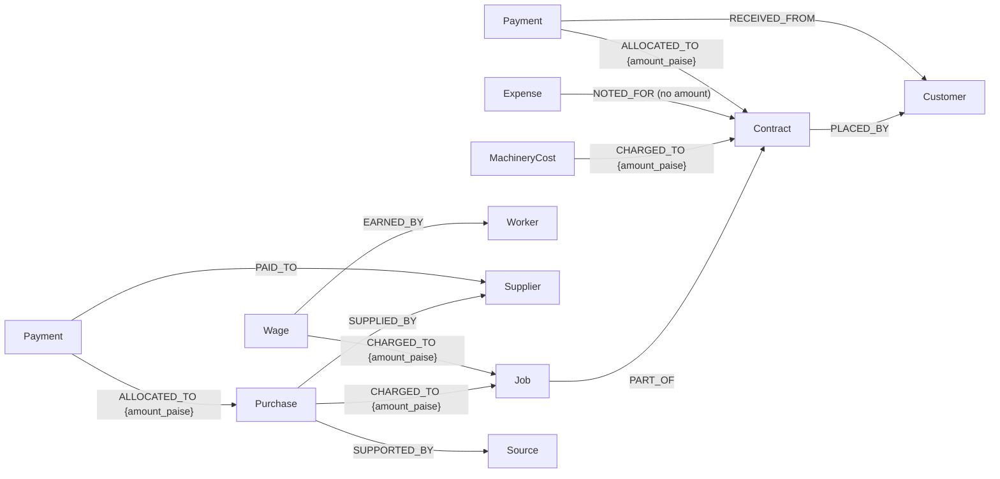

# Contract cost investigation (manufacturing)

A Node & Nerve application for a small manufacturer that keeps its records in paper books. It answers:

> How much has this contract cost so far, what is its provisional profitability, and what information is missing?

The business connects material purchases, wages, machinery costs, petty expenses, supplier payments and customer receipts that today sit in separate books. Node & Nerve stores them as a graph in FalkorDB, traverses the recorded links from a contract to every cost charged to it, and returns the figures with the entries, book pages and graph paths they came from. It also lists what the records do not settle: costs awaiting a split, unassigned labour, unconfirmed payments, books that disagree, and entries with no source.

It is not an accounting system or ERP and does not replace Tally or the CA. Every figure is labelled **provisional, based on recorded direct costs**.

## Run it

```sh
docker compose up -d falkordb
uv sync
uv run company-brain contracts seed --reset         # load Kaveri Body Works (synthetic)
uv run company-brain contracts investigate CT-104   # the primary investigation
uv run company-brain contracts overview             # all contracts, which are incomplete
uv run company-brain contracts unallocated          # costs not charged to any contract
uv run company-brain contracts demo                 # seed, re-seed (no change), new entries, diff
```

`--json` prints the full response; `--as-of YYYY-MM-DD` sets the reporting date (default 2026-10-16); `--company ID` before `contracts` selects another tenant (default `kaveri-body-works`). Full JSON for CT-104: [examples/contract-investigation.json](../examples/contract-investigation.json).

API (same API-key scoping as the rest of the service):

| Method | Path | Purpose |
| --- | --- | --- |
| POST | `/v1/companies/{company}/contracts/investigations` | `{"contract": "CT-104", "as_of": "2026-10-16"}`: the primary investigation |
| GET | `/v1/companies/{company}/contracts` | every contract with provisional figures and issues |
| GET | `/v1/companies/{company}/costs/unallocated` | costs not charged to any contract; unapplied supplier payments |
| GET | `/v1/companies/{company}/costs/changes?since=` | entries, payments and allocations added or changed since a timestamp |

## The synthetic business: Kaveri Body Works, Namakkal

A fictional lorry-body builder (platform, closed container and tipper bodies built on customers' chassis). Data: [src/company_brain/data/kaveri.json](../src/company_brain/data/kaveri.json), with later entries in `kaveri-updates.json`. Everything is invented: company, customers, suppliers, workers, vehicle numbers, amounts and book pages.

| | |
| --- | --- |
| Customers | 4 transport companies (Salem, Erode, Karur, Coimbatore) |
| Contracts | 5: CT-101 (2 platform, delivered, fully paid), CT-102 (container, delivered, ₹1,30,000 still to receive), CT-103 (tipper, completed, hydraulic kit supplied by the customer), **CT-104 (3 containers, ₹15,30,000, in production)**, CT-105 (2 platform, just started) |
| Jobs | 9 lorry bodies, each `PART_OF` its contract |
| Suppliers | 7: a regular steel supplier, an occasional steel supplier in Coimbatore, paint and hardware, welding stores, crane and machine hire, diesel, transport |
| Workers | 6: two welders, a fabricator, a painter, a helper, a fitter, with daily rates |
| Entries | 23 purchases (one void), 37 weekly wage entries, 5 machinery costs, 5 expenses, 22 supplier payments, 8 customer receipts (131 records in all) |
| Source records | 19: pages of the contract register, material purchase book, wage book, supplier payment book, machinery book, expense book, receipt book, plus a supplier bill and an electricity bill |

Every amount is integer paise. Purchases carry quantity, unit and unit price, and a test checks `quantity × unit price = amount` for each one. Another test checks that no split charges more than the entry.

### Deliberate data-quality cases

These are listed in the dataset's `_scenarios` and asserted by tests.

| Case | Entry | What the investigation reports |
| --- | --- | --- |
| One bill split across the three CT-104 bodies | PUR-2041, PUR-2042, PUR-2059 | each body carries its third |
| Bill shared across two contracts, split on the supplier's bill | PUR-2047 (₹1,38,000: 104B, 104C, 105A) | ₹92,000 in CT-104, ₹46,000 in CT-105; the bill is never counted twice |
| Freight shared 4,000/2,000 per the expense book | EX-401 | ₹4,000 in CT-104 |
| Shared paint with no split ("for 104 & 105") | PUR-2053 | **decision**: not counted anywhere until split |
| Helper wages "104/105", no split | WG-413 | **decision** |
| Job column blank | WG-416 | **unknown**: unassigned labour |
| Paid column blank | WG-417 | **unknown**: counted as cost, payment status unknown |
| Duplicate line struck out | PUR-2056 (void) | excluded, reported |
| Partly paid supplier bill | PUR-2042 (₹1,00,000 of ₹1,67,400), PUR-2031 | outstanding computed from cleared payments |
| Cheque not cleared | SP-307 for PUR-2055 | **unknown**: payment unconfirmed |
| Purchase book says "cash paid", payment book has nothing | PUR-2058 | **inconsistency** |
| ₹25,000 cash to a supplier with no bill written | SP-309 | **decision**: which bill it settles |
| Workshop overheads | EX-404 electricity, MC-403 generator diesel, MC-404 plasma maintenance, EX-402 consumables | **decision**: excluded from direct cost (₹39,790) |
| Entry on a loose slip, no book | MC-404 | **missing** source record |

## Graph model

The model extends the shared schema in [`schema.py`](../src/company_brain/schema.py). It reuses `customer`, `supplier`, `payment` and `source`, and the existing relationships `PLACED_BY`, `PART_OF`, `ALLOCATED_TO`, `SUPPORTED_BY` and `MENTIONS`. There is no Company node: each company already has its own graph, which is the isolation boundary. The company metadata lives in the dataset file.

| Kind (label) | Key properties |
| --- | --- |
| contract (`Contract`) | `amount_paise` (contract value), `contract_date`, `expected_completion`, `body_count`, `body_type`, `status` |
| job (`Job`) | `status`, `body_type`, `chassis_ref`, `started_on`, `completed_on` |
| worker (`Worker`) | `role`, `daily_rate_paise` |
| purchase (`Purchase`) | `purchase_date`, `material_type`, `item`, `quantity`, `unit`, `unit_price_paise`, `amount_paise`, `paid_status` (what the book says), `status` (`recorded`/`void`) |
| wage (`Wage`) | `work_date`, `period_end`, `days`, `work_type`, `amount_paise`, `paid_status`, `status` |
| machinerycost (`MachineryCost`) | `cost_date`, `cost_type` (`rental`, `fuel`, `maintenance`, `usage`), `machine`, `quantity`, `unit`, `amount_paise`, `paid_status`, `status` |
| expense (`Expense`) | `expense_date`, `category` (`electricity`, `transport`, `consumables`, `rent`, `other`), `amount_paise`, `paid_status`, `status` |



| Relationship | From → To | Meaning |
| --- | --- | --- |
| `CHARGED_TO {amount_paise}` | purchase, wage, machinerycost, expense → job, contract | The part of the entry borne by that job or contract. **The only way a cost reaches a contract.** |
| `NOTED_FOR` | cost entry → job, contract | The book links the entry to it but gives no amount. A pending decision; never counted. |
| `SUPPLIED_BY` | purchase, machinerycost, expense → supplier | |
| `EARNED_BY` | wage → worker | |
| `PAID_TO` | payment → supplier, worker | |
| `ALLOCATED_TO {amount_paise}` | payment → purchase, machinerycost, expense, contract (and invoice for Cashflow Radar) | How much of a payment settles that bill or contract |
| `PART_OF` | job → contract | |
| `PLACED_BY` | contract → customer | |

Every edge can carry `source_id`, the book page or bill that asserted it. Re-loading is idempotent (MERGE on stable ids such as `purchase:pur-2047`). An older version of an entry never overwrites a newer one.

## Calculation model

Returned with every result as `calculation_rules`:

1. **Recorded direct cost** = the sum of `CHARGED_TO.amount_paise` from valid (not void) purchase, wage, machinery and expense entries into the contract or one of its jobs. Categories: purchases → materials, wages → labour, machinery → machinery, expenses → other direct.
2. A shared bill counts only for the portion charged here.
3. Voided entries are excluded and reported.
4. A charge with no amount is excluded and reported as unknown, **not zero**.
5. `NOTED_FOR` entries (no split) are excluded and reported as decisions, with the amount still to split. The result also gives a lower bound: provisional profit if every such item were charged entirely to this contract. That is a sensitivity, not an allocation.
6. Overheads not charged to any contract are excluded by rule and reported (₹39,790 here).
7. **Provisional profit** = contract value − recorded direct cost. No GST, depreciation, inventory valuation or overhead absorption is applied.
8. **Payments are never cost or revenue.** A supplier payment reduces what is owed on a bill; a customer receipt reduces what is still to be received on the contract. Only `cleared` payments count as paid.
9. **Supplier outstanding** per bill = bill amount − cleared payments applied to it. For a shared bill this is the whole bill's balance and is labelled as shared. Petty expenses are paid out of the expense book itself, so their outstanding amount follows that book's paid column.
10. **Reconciliation** compares the book's `paid_status` with the payment records: `consistent`, `unconfirmed` (covered only by pending payments), `mismatch`, or `not_recorded`.

Money is integer paise throughout; the margin percentage uses `Decimal` with half-up rounding to one decimal.

CT-104 on 16 Oct 2026, from the seed data:

| | |
| --- | --- |
| Materials | ₹7,59,900 |
| Labour | ₹71,500 |
| Machinery | ₹11,800 |
| Other direct | ₹8,500 |
| **Recorded direct cost** | **₹8,51,700** (35 charged entries; PUR-2056 void excluded) |
| Contract value | ₹15,30,000 |
| **Provisional profit** | **₹6,78,300 (44.3%)** |
| Unsplit costs noted for it | ₹32,100 (PUR-2053, WG-413); lower bound ₹6,46,200 |
| Customer paid / still to receive | ₹8,00,000 / ₹7,30,000 |
| Supplier balances on its bills | MC-401 ₹7,000; PUR-2042 ₹67,400; PUR-2047 ₹1,38,000 (shared with J-105A); PUR-2055 ₹31,000 (cheque pending); PUR-2058 ₹58,000 (book says paid) |

The margin is high because CT-104 is still in production: most steel is bought, but labour and finishing are not done. The result says so in its warnings.

After `contracts demo` applies the 16 Oct entries, recorded cost becomes ₹8,80,780 and provisional profit ₹6,49,220 (42.4%). The entries are: the cheque clears, the owner splits the paint (₹19,000 to 104B, ₹9,500 to 105A) and assigns Murugan's week to 104B, and a new ₹6,480 purchase is booked. The paint and labour decisions and the unconfirmed payment disappear from the result.

A test checks the key invariant over the whole dataset: the sum of all contracts' recorded costs plus all unallocated costs equals the sum of all valid entries. Nothing is lost and nothing is counted twice.

## What the investigation returns

`ContractCostResponse` ([`contract_cost.py`](../src/company_brain/contract_cost.py)): `contract` (summary and jobs), `cost_breakdown`, `profitability`, `customer_account`, `supplier_bills` (with reconciliation), `wages_unpaid`, `cost_lines` (each with its path id and sources), `pending_allocations`, `findings`, `decisions_required`, `missing_information`, `warnings`, `calculation_rules`, `evidence_paths`, `sources`, `queries_executed`.

Each finding has a `kind`:

- `fact`: recorded and backed by a source.
- `calculation`: derived by the rules above.
- `unknown`: not recorded.
- `inconsistency`: two books disagree.
- `decision`: a person must decide before the figure is complete.

## How FalkorDB does the work

Eight read-only templates in [`queries.py`](../src/company_brain/queries.py) (`mf_*`), parameterized, with labels from enums and bounded traversals.

The core traversal returns one row per charge with the path it walked:

```cypher
MATCH path = (c:Contract {id: $id})<-[:PART_OF*0..1]-(t:Entity)<-[ch:CHARGED_TO]-(rec:Entity)
WHERE rec.kind IN $cost_kinds
RETURN rec.kind AS kind, properties(rec) AS record, t.id AS charged_to,
       ch.amount_paise AS charged_paise, ch.source_id AS charge_source_id,
       [r IN relationships(path) | {type: type(r), from: startNode(r).id, to: endNode(r).id,
                                    source_id: r.source_id}] AS rels,
       [(rec)-[o:CHARGED_TO]->(xc:Entity) | {id: xc.id, amount_paise: o.amount_paise}] AS all_charges,
       [(rec)-[:SUPPLIED_BY]->(s:Supplier) | {id: s.id, name: s.name}] AS suppliers,
       [(rec)-[:EARNED_BY]->(w:Worker) | {id: w.id, name: w.name, role: w.role}] AS workers,
       [(pay:Payment)-[a:ALLOCATED_TO]->(rec) | {id: pay.id, status: pay.status,
                                                amount_paise: a.amount_paise}] AS payments, …
```

`*0..1` covers costs charged directly to the contract and costs charged to one of its jobs in one pattern. `all_charges` shows where else a shared bill went, without a second query.

The graph also:

- computes category totals (`mf_contract_cost_totals`), which are cross-checked against the itemised rows;
- finds costs that are noted for the contract but unsplit (`mf_contract_noted`);
- finds costs not fully charged anywhere, computing the charged sum per entry (`mf_unallocated`);
- finds supplier payments not applied to any bill (`mf_unapplied_payments`);
- summarizes every contract's recorded cost and cleared receipts (`mf_contracts_overview`);
- lists what changed since a timestamp (`mf_changed_since`).

Remove FalkorDB and there is no answer. Which costs belong to a contract, through which job, on what split, settled by which payment, and asserted by which book page are all relationships the graph holds and traverses. The same engine, isolation and evidence model also serve Project Atlas.

FalkorDB v4.20.7 note: reusing a variable name across pattern comprehensions in one `RETURN` made later comprehensions come back empty, so every comprehension uses its own names.

## Data capture: next step (assessed, not built)

The prototype loads synthetic seed data. In order of simplicity, the next input paths are:

1. **CSV import.** Best next step. Cashflow Radar already has a validate-then-write importer ([`csv_import.py`](../src/company_brain/csv_import.py)) with row-level errors, company checks, provenance and idempotency. Adding `purchases.csv`, `wages.csv`, `machinery.csv`, `expenses.csv`, `supplier_payments.csv` and `allocations.csv` (with an explicit `amount` per job) is mostly declaring columns, with one rule: a row with a job but no amount becomes `NOTED_FOR`, never a guessed split.
2. **A simple entry form** over the same validation, for the supervisor entering the day's wage book.
3. **Photos of book pages** or **WhatsApp messages**: extracted values must stay *candidates* until a person confirms each one. Only confirmed values become entries, and the photo becomes the `source` record.

None of these are implemented. Google Sheets, WhatsApp, Telegram, OCR and a frontend are out of scope for this milestone.

## Using it from an AI agent

[examples/agent/contract_tools.json](../examples/agent/contract_tools.json) defines four tools in Anthropic tool-use format, each mapped to one endpoint above. A unit test keeps their schemas in sync with the API. [examples/agent/system_prompt.md](../examples/agent/system_prompt.md) gives the grounding rules:

- every figure comes from a tool result;
- profit is always called provisional;
- cite `source_ids`;
- report decisions, unknowns and inconsistencies without resolving them;
- never split a cost, assign labour or assume a payment.

**Not tested with a live model**: no LLM API key was available in this environment, and the engine itself needs none.

## Limitations

- Synthetic data only, written by the same author as the queries: correct results show the queries do what the data encodes, not real-world accuracy.
- One reporting view per contract. No period cut-off by date (`as_of` is the reporting date only), no committed-but-unbilled costs, no budget or estimate to compare against.
- No GST, TDS, depreciation, inventory or work-in-progress valuation, and no overhead absorption. By design these are left to the CA.
- Shared bills report supplier outstanding for the whole bill; the balance is not apportioned to contracts.
- An updated entry keeps only its latest values. Allocation decisions are added as new `CHARGED_TO` edges, and the earlier `NOTED_FOR` stays as history.
- Up to 1,000 charge rows per contract (warning if reached).
